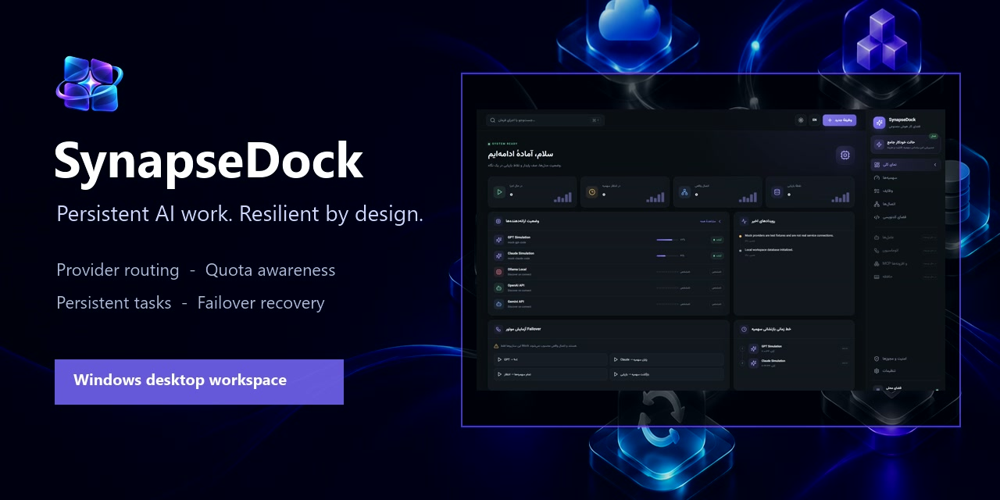
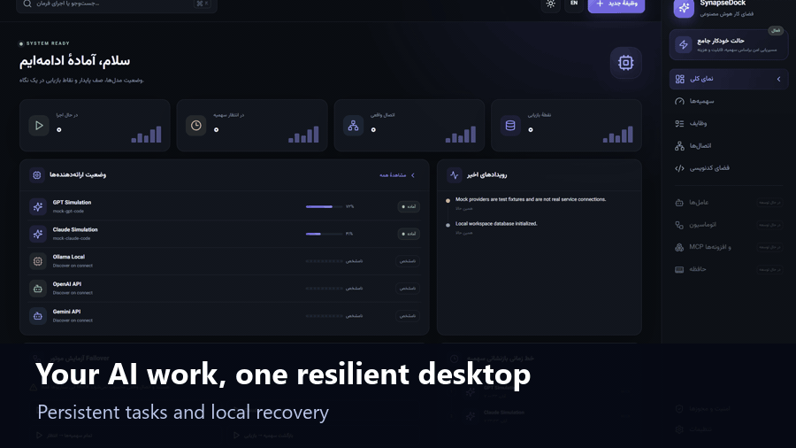
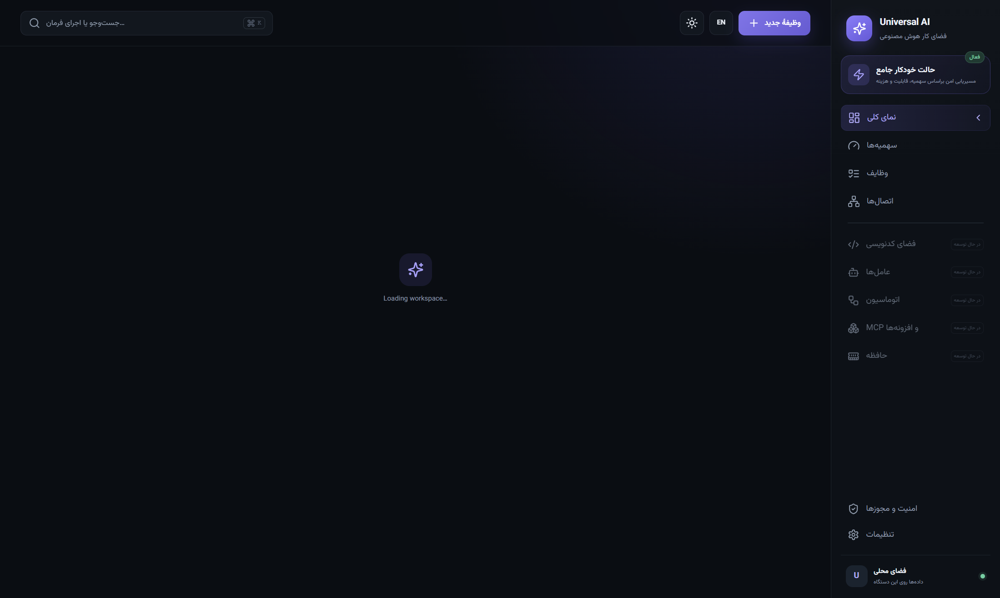
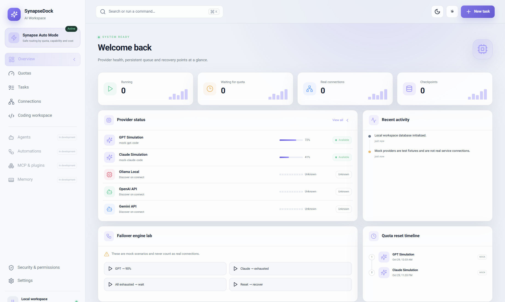

<p align="center">
  
</p>

<h1 align="center">SynapseDock</h1>

<p align="center">
  A Windows desktop workspace for persistent, quota-aware AI operations.
</p>

<p align="center">
  <a href="https://github.com/asgharssibil/synapsedock/actions/workflows/ci.yml"></a>
  <a href="https://github.com/asgharssibil/synapsedock/releases/latest"></a>
  
  
</p>

<p align="center">
  <a href="https://github.com/asgharssibil/synapsedock/releases/download/v0.2.0/SynapseDock-Setup-0.2.0.exe"></a>
</p>



SynapseDock keeps provider health, persistent tasks, quota state, checkpoints, and recovery experiments in one bilingual desktop workspace. The current release is an honest foundation: production-grade local storage and security are implemented, while mock providers and planned integrations are clearly identified.



## Why SynapseDock?

- **One operational view** — provider readiness, quota state, tasks, checkpoints, and recent activity at a glance.
- **Persistent by default** — SQLite-backed tasks and recovery records survive restarts.
- **Resilience lab** — test exhaustion, waiting, failover, and recovery flows without spending API credits.
- **Local-first security** — credentials use Electron `safeStorage`; the renderer is sandboxed and has no Node.js access.
- **Bilingual desktop UI** — switch between Persian/RTL and English/LTR, in dark or light mode.
- **Local coding scratchpad** — write and keep code drafts on-device while terminal execution remains explicitly out of scope for this release.
- **Consent-aware routing** — free-only tasks never select paid providers without explicit configuration and consent.

## Screenshots

<table>
  <tr>
    <td width="50%"></td>
    <td width="50%"></td>
  </tr>
  <tr>
    <td align="center">Persian · RTL · dark</td>
    <td align="center">English · LTR · light</td>
  </tr>
</table>

## What works in v0.2.0

| Area | Implemented |
| --- | --- |
| Desktop shell | Hardened Electron runtime with context isolation, renderer sandboxing, deny-by-default permissions, and blocked external navigation |
| Persistence | Local SQLite database for accounts, tasks, checkpoints, activity, settings, and idempotency records |
| Credentials | OS-backed encrypted storage through Electron `safeStorage` |
| Routing model | Provider-agnostic quota assessment, free-only policy, and failover selection |
| Testing lab | Mock quota, exhaustion, waiting, failover, reset, and recovery scenarios |
| Account sign-in | Official ChatGPT system-browser OAuth/PKCE plus an opt-in experimental bridge to the official Claude Code CLI |
| Connection checks | Read-only verification for 16 official APIs spanning text/code, image/video and audio, plus local Ollama |
| Experience | Persian/English, RTL/LTR, dark/light, installer shortcuts, and clean uninstall |
| Preferences | Persistent language and theme settings with a compact-height-safe sidebar |
| Coding | Local draft editor for TypeScript, Python, PowerShell, and plain text; execution is not yet implemented |
| Local modules | Clickable Agents, Automations, MCP configuration, Memory, and Security workspaces with on-device persistence |

> [!IMPORTANT]
> Mock providers are simulations, not real service connections. SynapseDock does not claim access to consumer web subscriptions, and it displays `Unknown` whenever a provider does not expose an exact quota value.

### New in v0.2.0

- Official **Sign in with ChatGPT** through system-browser OAuth/PKCE. Account eligibility still controls whether plan usage is granted.
- An opt-in **experimental Claude Code bridge**. It invokes Anthropic's official CLI after the user signs in on Claude's official page; SynapseDock does not read Claude cookies, passwords, or stored tokens.
- Claude verification runs one fixed prompt with Safe Mode, all tools disabled, MCP denied, one turn, no session persistence, and API-key environment variables removed. The bridge is disabled by default and the verification request may consume subscription usage.
- A **16-provider connection catalog** for text/code, image/video, and audio services, available from both Connections and Settings. It includes Kimi, Mistral, Cohere, DeepSeek, OpenRouter, Groq, Together, Hugging Face, Replicate, Stability AI, Runway, and ElevenLabs in addition to the original four.
- Agents, Automations, MCP configuration, Memory, and Security are now clickable local workspaces rather than disabled sidebar placeholders. Saving these local definitions does not silently start external work.

SynapseDock intentionally does not implement browser-cookie scraping, consumer-session token extraction, client impersonation, or authentication bypass.

See the [provider catalog](docs/PROVIDERS.md) for connection method, media type, verification boundary, and official references.

## Install on Windows

1. [Download `SynapseDock-Setup-0.2.0.exe`](https://github.com/asgharssibil/synapsedock/releases/download/v0.2.0/SynapseDock-Setup-0.2.0.exe).
2. Verify the installer against [`SHA256SUMS.txt`](https://github.com/asgharssibil/synapsedock/releases/download/v0.2.0/SHA256SUMS.txt).
3. Run the installer and choose the destination folder.

The current x64 installer is unsigned, so Windows SmartScreen may display an **Unknown publisher** warning. The published checksum file lets you verify the download before running it.

No API key is needed for the workspace or mock scenarios. Add credentials only through **Connections** inside SynapseDock; never commit them to source control.

## Run from source

Requirements: Windows 10 or 11, Node.js 20+, and npm.

```powershell
git clone https://github.com/asgharssibil/synapsedock.git
cd synapsedock
npm ci
npm run test:coverage
npm run test:e2e
npm run dev
```

Build the Windows installer locally with:

```powershell
npm run dist:win
```

## Verification

The automated suite covers routing decisions, quota states, validation, persistence, security policy, and renderer behavior. Electron end-to-end tests launch the packaged runtime in isolated app-data directories and verify renderer mounting, preload/IPC, SQLite restart recovery, screenshot generation, and OS-backed credential encryption.

## Project status and roadmap

SynapseDock v0.2.0 is an early multi-provider desktop foundation, not a finished universal AI client. API credentials can be verified and stored securely, while full generation workflows and autonomous execution remain future work unless explicitly marked implemented.

- [Development state](DEVELOPMENT_STATE.md)
- [Architecture](docs/ARCHITECTURE.md)
- [Compatibility matrix](docs/COMPATIBILITY.md)
- [Security model](docs/SECURITY.md)
- [Release notes](RELEASE_NOTES_v0.2.0.md)

Found a bug or have a workflow SynapseDock should support? [Open an issue](https://github.com/asgharssibil/synapsedock/issues/new) with the Windows version, steps to reproduce, and expected behavior.

## License

SynapseDock is publicly visible but proprietary software. Copyright is retained by the owner; copying, modification, redistribution, sublicensing, or sale requires prior written permission. See [`LICENSE`](LICENSE).
